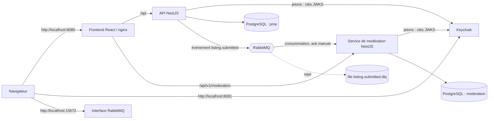

# La Petite Maison de l'Épouvante — POC fonctionnel

POC de la plateforme en ligne : un membre dépose une annonce de troc, elle est transmise de façon asynchrone
au service de modération, qui la place dans la file de modération.
Il démontre que les technologies retenues fonctionnent ensemble : **Keycloak, React, NestJS, RabbitMQ, PostgreSQL, Minikube**
(la chaîne **GitLab CI/CD** sera ajoutée ensuite).

## Parcours démontré

| Étape | Ce qui se passe | Brique |
|---|---|---|
| 1. Connexion | Redirection vers Keycloak (Authorization Code + PKCE), retour sur React avec le nom et le rôle « Membre » | Keycloak, React |
| 2. Dépôt | Le formulaire envoie l'annonce ; l'API vérifie le jeton, le rôle et les données, enregistre l'annonce « en attente de modération » | React, NestJS, PostgreSQL |
| 3. Modération | L'API publie `listing.submitted` dans RabbitMQ et répond sans attendre ; le service de modération, séparé, consomme le message et place l'annonce dans la file | RabbitMQ, NestJS |

Hors périmètre : validation/refus par le modérateur, paiement, e-mails, recommandations, chat, haute disponibilité,
hébergement réel en Europe, chaîne CI/CD.

## Architecture



Choix qui servent la démonstration :
- **Deux services, deux bases.** Le service de modération a sa propre base (`moderation`) et n'ouvre jamais celle de l'API : pas de couplage caché.
- **Message acquitté à la main**, avec trois issues distinctes. Service de modération arrêté : les annonces restent dans la file RabbitMQ et sont traitées au redémarrage. Panne passagère (base indisponible) : le message est remis dans la file et retraité une fois la panne terminée. Message invalide : rejeté vers `listing.submitted.dlq`, car le rejouer donnerait le même résultat. Message rejoué : sans effet (clé unique sur l'annonce).
- **Contrôle d'accès par rôles Keycloak.** `membre` dépose des annonces ; l'endpoint de la file de modération exige le rôle `moderateur` et renvoie **403** à un membre. L'interface ne montre que l'espace membre : la file relève du back-office et se vérifie par `make smoke` ou `make db-moderation`.
- **Pas de compte dans l'application.** L'API et le service de modération sont de simples *resource servers* : signature (JWKS), émetteur (`iss`), expiration, client (`azp`).

## Prérequis

Docker, Minikube, kubectl, make, Node 22 (pour le développement local et les tests), python3 (scripts).
Pas de droits administrateur nécessaires : ni `/etc/hosts`, ni `minikube tunnel`.

## Démarrage

```bash
cp .env.example .env          # valeurs de démonstration
make minikube-up              # démarre Minikube
make image                    # construit les 3 images dans Minikube
make deploy                   # secrets + Postgres, RabbitMQ, Keycloak, API, modération, front
make pods                     # attendre que tout soit Running (Keycloak met ~1 min)
make port-forward             # ouvre l'application sur le poste
```

Puis ouvrir **http://localhost:8080**. Tout passe en HTTP simple, par `kubectl port-forward` :
aucun ingress, aucun certificat à accepter, aucune ligne à ajouter dans `/etc/hosts`, aucun `minikube tunnel`.

| Adresse | Quoi |
|---|---|
| http://localhost:8080 | L'application (le serveur nginx du front relaie aussi `/api` vers les deux services) |
| http://localhost:8081 | Keycloak |
| http://localhost:15672 | Interface de gestion RabbitMQ |
| http://localhost:8080/api/docs | Swagger de l'API |

`make stop-forward` arrête les redirections.

| Utilisateur | Mot de passe | Rôles |
|---|---|---|
| `membre` | `membre` | membre |
| `moderateur` | `moderateur` | membre, moderateur (back-office, non utilisé dans l'interface) |

Console d'administration Keycloak : http://localhost:8081 (identifiants dans `.env`). RabbitMQ : http://localhost:15672 (utilisateur et mot de passe de `.env`).

## Dérouler la démonstration

1. `make pods` — tout tourne sur Minikube.
2. Se connecter en `membre` : le bandeau affiche le nom et le rôle « Membre ».
3. Déposer une annonce (essayer d'abord un titre vide : l'API la rejette avec le détail de l'erreur).
4. Annonce valide : l'API répond immédiatement, l'annonce apparaît dans « Mes annonces » au statut « En attente de modération ». Le membre n'attend pas la modération.
5. Montrer que l'événement a bien traversé RabbitMQ, au choix : l'interface RabbitMQ (onglet *Queues*, graphique *Message rates*), `make logs-moderation` (le service annonce la réception du message), ou `make db-moderation` (la ligne est arrivée dans la base de modération).

Le POC ne présente que l'espace membre : la file de modération est un back-office, hors périmètre de l'interface. Le service de modération, lui, tourne bien et consomme les messages — c'est ce que montre l'étape 5.

Pour aller plus loin, sans changer le scénario :
- `make demo-stop-moderation`, déposer une annonce, `make queues` (le message attend), puis `make demo-start-moderation` : la file se vide.
- `make demo-kill-api` : Kubernetes recrée le pod.
- `make smoke` : le même scénario en ligne de commande (connexion, 401, 400, 201, 403, file), avec un résultat par vérification.
- `make db-listings` / `make db-moderation` : l'annonce dans chaque base.

## Développement local

Infrastructure dans Minikube, services sur votre machine :

```bash
make install && make port-forward        # Postgres :5432, RabbitMQ :5672, Keycloak :8081
make dev-api                             # http://localhost:3000   (Swagger : /api/docs)
make dev-moderation                      # http://localhost:3001  (consommateur RabbitMQ)
make dev-frontend                        # http://localhost:5173   (proxy vers 3000 ; URL de retour déjà déclarée dans le realm)
```

Les tests sont décrits plus bas (« Stratégie de tests »).

## Structure

```
├── frontend/             React + Vite + Tailwind CSS + keycloak-js (image nginx sans privilèges)
├── api/                  NestJS : dépôt d'annonces, publication de l'événement
├── moderation-service/   NestJS : consommateur RabbitMQ + file de modération
├── k8s/                  Manifestes Minikube (kustomize) + config (realm Keycloak, init Postgres, config du front)
├── tests/
│   ├── image/            container-structure-test (une configuration par image)
│   └── performance/      scénarios k6 (charge, découplage)
├── scripts/              smoke.sh, token.sh, perf-decoupling.sh
├── Makefile
└── .env.example
```

## Base de données

PostgreSQL 16, une instance et trois bases : `pme` (API), `moderation` (service de modération) et `keycloak`.

- **Création des bases** : `k8s/config/postgres-init.sh`, exécuté une seule fois à l'initialisation du volume.
- **Création des tables** : migrations TypeORM versionnées, appliquées automatiquement au démarrage de chaque service (`migrationsRun`) ; `synchronize` est désactivé.
  - API : `api/src/migrations/1730000000000-create-listings.ts` (table `listings`, contraintes sur l'état et le statut, index par propriétaire)
  - Modération : `moderation-service/src/migrations/1730000000000-create-moderation-queue.ts` (table `moderation_queue`, `listing_id` unique pour l'idempotence)
- **Repartir de zéro** : `make reset` (supprime le namespace, donc le volume, puis redéploie).

## Interface : Tailwind CSS

Le front utilise **Tailwind CSS 4**, intégré par le plugin officiel Vite (`@tailwindcss/vite`). Il n'y a pas de
`tailwind.config.js` : en version 4, le thème se déclare dans la feuille de styles, ici
[`frontend/src/styles.css`](frontend/src/styles.css).

- **Jetons de design** : la palette (thème clair — `page`, `panel`, `inset` pour les surfaces ; `ink` pour le texte ;
  `blood` pour l'accent ; `moss` et `ember` pour les états ; `focus` pour l'indicateur de focus) et la police des
  titres sont déclarées dans `@theme`. Les composants n'écrivent jamais une couleur en dur.
- **Accessibilité** : la palette est conforme WCAG 2.1 AA / RGAA 4, et `frontend/src/theme.test.ts` le vérifie
  automatiquement à chaque exécution des tests — 26 contrôles sur les associations réellement utilisées. Voir
  [docs/QUALITE.md](docs/QUALITE.md).
- **Convention** : la mise en page s'écrit en classes utilitaires dans le JSX ; seuls les éléments répétés au moins
  trois fois (`card`, `field`, `label`, `btn`, `pill`, `notice`) sont extraits en classes de composant avec `@apply`.
- **Variantes selon une donnée** (rôle, statut d'annonce) : chaque variante est une chaîne de classes complète dans un
  `Record` typé du composant. Tailwind analyse le code source en texte : une classe construite à la volée
  (`` `text-${couleur}` ``) ne serait jamais générée.
- **Tri des classes** : `prettier-plugin-tailwindcss`, appliqué par `make format` et vérifié par `make format-check`.

Feuille compilée : environ 11 ko (3 ko compressés), seules les classes réellement utilisées sont émises.

## Qualité logicielle

Attributs de qualité visés, contrôles et étapes du pipeline : [docs/QUALITE.md](docs/QUALITE.md).
`make quality` lance tout le contrôle statique (ESLint + complexité, Prettier, yamllint, hadolint, kustomize/kubeconform,
gitleaks, npm audit) ; `make coverage` produit la couverture lue par SonarCloud (projet `kitaah_pme`, configuration dans `sonar-project.properties`, détails dans [docs/QUALITE.md](docs/QUALITE.md#3-sonar-sonarcloud)).
Le pipeline GitLab ([.gitlab-ci.yml](.gitlab-ci.yml)) est un brouillon non exécuté.

## Stratégie de tests

| Type | Outils | Exemples dans le dépôt | Commande | Place dans la chaîne CI/CD |
|---|---|---|---|---|
| **Unitaires** | Jest (API, modération), Vitest + React Testing Library (front) | `ListingsService` : annonce retirée et 503 si la publication échoue ; consommateur : ack, nack, doublon ; `ListingForm` : erreurs de l'API affichées ; `MyListings` : libellés des trois statuts, alerte si l'API est injoignable ; `theme` : conformité WCAG/RGAA de chaque couple de couleurs | `make test` | À chaque commit |
| **Intégration** | Jest + Testcontainers : PostgreSQL et RabbitMQ réels, faux serveur de clés Keycloak | Message conservé tant que la modération est arrêtée, puis traité ; message invalide envoyé en file d'échec ; contrat du message publié par l'API | `make test-integration` (Docker requis) | À chaque demande de fusion |
| **Image Docker** | container-structure-test, Trivy | Utilisateur non-root, port, aucun outil de développement ni source dans l'image ; aucune vulnérabilité HIGH/CRITICAL corrigeable | `make image-test` (images construites) | Juste après la construction de l'image |
| **Performance** | k6 | Charge à 20 utilisateurs virtuels (p95 < 500 ms, moins de 1 % d'erreurs) ; temps de réponse du dépôt identique service de modération en marche ou arrêté | `make perf-prepare`, `make perf`, `make perf-reset` | Après le déploiement en recette, pas à chaque commit |

Choix d'outils :
- **Jest côté NestJS** : outil par défaut du framework, utilisé avec supertest. **Vitest côté React** : pendant naturel de Vite.
- **Testcontainers** : même approche que le projet Spring (`TestcontainersConfiguration`), et seul moyen de tester le vrai broker.
- **k6 plutôt que JMeter** : scripts en JavaScript comme le reste du projet, seuils de réussite écrits dans le code (le pipeline échoue seul). JMeter reste le standard historique ; le plan du projet Spring (`jmeter/`) peut être réutilisé si besoin.
- Les tests d'intégration utilisent un faux serveur de clés Keycloak : signature, émetteur, expiration et client des jetons sont vraiment vérifiés, sans démarrer Keycloak. `make smoke` couvre le vrai Keycloak.

Prérequis des tests d'image et de performance : `container-structure-test`, `trivy` et `k6` installés sur la machine.
`make perf-prepare` relève la limitation de débit de l'API (200 requêtes par minute et par IP), sinon k6, qui envoie tout depuis une seule adresse, recevrait des erreurs 429 ; `make perf-reset` la rétablit.

## Ce qui vient du projet Spring Boot

| Projet Spring | Dans ce POC |
|---|---|
| `Makefile` (minikube-up, deploy, redeploy, port-forward, logs, open-*) | Conservé et adapté : mêmes noms de cibles, trois images, `NS=` pour le namespace |
| `k8s/` Postgres, Keycloak, Deployment, Service, Ingress, cert-manager | Repris, simplifiés : un seul `kubectl apply -k`, bases créées automatiquement (plus de `make create-keycloak-db`), **ni ingress ni TLS** : accès par `kubectl port-forward` en HTTP, le serveur nginx du front servant de point d'entrée unique |
| Flyway (`V1__create_subscriptions.sql`) | Migrations TypeORM versionnées, `synchronize` désactivé |
| `JwtAuthConverter` + `SecurityConfig` (resource server, rôles Keycloak) | `JwtStrategy` + gardes de rôles, refus par défaut |
| `GlobalExceptionHandler` (RFC 9457) | `ProblemDetailsFilter` : mêmes réponses `application/problem+json` |
| Resilience4j `@Retry` | `timeout` + `retry` RxJS sur la publication ; compensation si le broker est injoignable (503, annonce retirée) |
| Bucket4j `RateLimitFilter` | `@nestjs/throttler`, par IP (`trust proxy` : l'adresse réelle vient du `X-Forwarded-For` posé par le nginx du front) |
| Actuator `/health/liveness`, `/readiness` | `/api/health/liveness`, `/api/health/readiness` |
| springdoc / Swagger | `@nestjs/swagger` sur `/api/docs` |
| Tests `*IT` (Testcontainers) et `*Test` | Tests unitaires + tests d'intégration Testcontainers (PostgreSQL et RabbitMQ réels) |
| Dockerfile multi-étapes, utilisateur non-root | Même principe pour les trois images |

**Laissé de côté** (hors POC, récupérable dans le projet Spring) : Prometheus/Grafana, HPA, Mailpit/e-mails, pgAdmin, JMeter/Siege,
MkDocs, Sealed Secrets (voir [docs/QUALITE.md](docs/QUALITE.md), « Secrets : où s'arrête le POC »). Le plan JMeter reste dans le projet Spring ; ici les tests de performance sont en k6.

## Limites connues

- **Vérifié ici** : compilation des trois applications ; tests unitaires (API 8, modération 11, frontend 32 dont 26 de contraste) ; tests d'intégration sur un vrai PostgreSQL
  (API 14, modération 6) ; import du realm dans un vrai Keycloak 24 et validation de ses jetons par l'API ; exécution des scénarios k6 (connexion, dépôt, seuils) contre l'API ;
  rendu et validation des manifestes (kustomize + schémas Kubernetes 1.30) ; construction du front ; conformité
  WCAG/RGAA de la palette (26 contrôles automatisés) ; `frontend/nginx.conf` : syntaxe, en-têtes HTTP, et routage réel
  de `/api` et `/api/v1/moderation` vers les deux services ; import du realm dans un Keycloak 24 vierge, émetteur
  `http://localhost:8081/realms/pme`, URL de retour `http://localhost:8080` acceptée et toute autre refusée ;
  acceptation par l'API d'un vrai jeton émis en HTTP (401 sans jeton, 400 sur données invalides, 503 avec compensation
  si le broker est absent).
- **Non vérifié ici** (pas de Docker dans mon environnement) : les tests d'intégration avec un vrai RabbitMQ (`*-broker.integration-spec.ts`, écrits et compilés mais jamais exécutés),
  les tests d'image, la construction des images et le déploiement sur Minikube. Premier essai conseillé : `make test-integration`, puis `make smoke`.
- RabbitMQ n'a pas de stockage persistant : les messages survivent à l'arrêt du service de modération, pas à la perte du pod RabbitMQ.
- Les mots de passe des utilisateurs de démonstration et le client `pme-cli` (mot de passe direct, pour `make smoke`) sont réservés au POC.
- **Enregistrement et publication ne sont pas atomiques.** L'API enregistre l'annonce puis publie l'événement en deux
  temps. Si le processus meurt entre les deux (c'est exactement ce que provoque `make demo-kill-api`), l'annonce reste
  « en attente de modération » sans que personne ne la voie passer. Correctif attendu en production : table de sortie
  (*outbox*) écrite dans la même transaction, relue par un publieur. Hors périmètre du POC.
- **La compensation peut laisser une ligne orpheline.** Si le broker confirme après le délai de 3 s, la publication est
  retentée puis l'annonce est supprimée et un 503 renvoyé, alors que le message est bien parti : le modérateur voit une
  annonce que son auteur croit refusée. Même correctif que ci-dessus.
- Une panne passagère de la base côté modération **ne perd plus** le message : il est remis dans la file et retraité
  (seul un message au contenu invalide part en file d'échec). Rien ne rejoue automatiquement cette file d'échec.
- `/api/docs` et `/api/docs-json` sont accessibles sans jeton : Swagger s'enregistre hors du routeur NestJS, la garde
  globale ne s'y applique pas. À désactiver (`SWAGGER_ENABLED=false`) ou à protéger en amont en production.
- `NS` du Makefile ne pilote que les commandes `kubectl` : le namespace est fixé dans `k8s/kustomization.yaml`.
  De même, changer `FRONT_PORT` ou `KEYCLOAK_PORT` ne suffit pas : ces ports figurent aussi dans les URL de retour du
  realm Keycloak, dans `k8s/config/frontend-config.js` et dans `--hostname-url` de Keycloak.
- **Accès en HTTP, sans TLS.** C'est un choix de simplification pour la démonstration locale : pas d'ingress, pas de
  certificat auto-signé à accepter, pas de modification de `/etc/hosts`. En production, le TLS serait terminé par
  l'ingress ou le répartiteur de charge, et `--hostname-url` de Keycloak pointerait vers le domaine public.
- Le realm Keycloak (`k8s/config/realm-pme.json`, 650 lignes de configuration de sécurité) n'est couvert par aucun lint :
  `yamllint` ne traite que les fichiers `.yaml`/`.yml`.
- **22 fichiers sont identiques entre l'API et le service de modération** : tout `src/auth/`, le filtre d'erreurs
  RFC 9457, le contrôleur de santé et le harnais de tests `test/support/`. À factoriser en bibliothèque partagée ;
  en l'état, Sonar remontera cette duplication.
