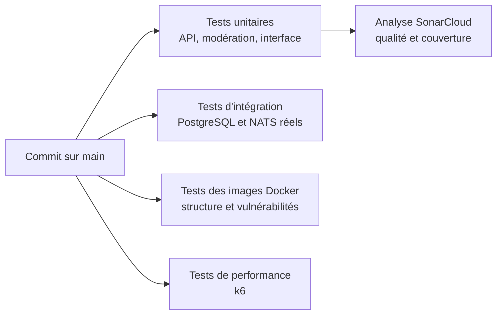

# Pipeline CI/CD

## Fiche d'identité

| Information | Détail |
|---|---|
| **Rôle** | Vérifie automatiquement la qualité du code et des images à chaque modification de la branche principale |
| **Plateforme** | GitLab CI/CD, offre gratuite (400 minutes de calcul par mois) |
| **Configuration** | Le fichier `.gitlab-ci.yml`, à la racine du dépôt |
| **Déclencheur** | Chaque commit ou fusion sur la branche principale (`main`) |
| **Durée visée** | Moins de 5 minutes par pipeline |
| **Nombre de jobs** | 7 jobs, répartis en 5 familles de contrôles |

## Description

Une pipeline est une suite de tâches que GitLab lance seul, sans intervention humaine. Chaque tâche s'appelle un job.
Chaque job démarre dans un conteneur neuf, fait un contrôle précis, puis publie son résultat. Si un contrôle échoue,
la pipeline devient rouge et l'équipe le voit tout de suite.

La pipeline du projet vérifie quatre choses : le code se comporte comme prévu, les services fonctionnent ensemble, les
images Docker sont sûres, et l'API reste rapide. Une cinquième analyse note la qualité générale du code.

**Définitions**

- **Pipeline** : ensemble des jobs lancés pour un commit.
- **Job** : tâche de la pipeline, par exemple « lancer les tests de l'API ».
- **Runner** : machine de GitLab qui exécute les jobs.
- **Artefact** : fichier produit par un job et conservé, comme un rapport de tests.
- **Seuil** : limite à respecter, par exemple une couverture minimale. Si elle n'est pas atteinte, le job échoue.

## Rôle dans le projet

- Elle contrôle chaque exigence de qualité du projet par au moins un test. Voir la page [Exigences qualité](exigences-qualite.md).
- Elle empêche une régression d'arriver sur la branche principale sans que l'équipe la voie.
- Elle garde une trace de chaque contrôle : rapports de tests, couverture, analyse des vulnérabilités.
- Sans elle, les contrôles dépendraient de la mémoire de chaque développeur.

## Schéma de la pipeline

Les jobs n'attendent pas les uns les autres : ils démarrent ensemble. Seule l'analyse SonarCloud attend les rapports
de couverture des tests unitaires. La durée de la pipeline est donc celle du job le plus long.

## Les jobs

| Job | Ce qu'il contrôle | Se lance si |
|---|---|---|
| `unit-tests:api` | Les 14 tests unitaires de l'API et leur couverture. | Le code d'un module change. |
| `unit-tests:moderation-service` | Les 17 tests unitaires du service de modération. | Le code d'un module change. |
| `unit-tests:frontend` | Les 35 tests unitaires de l'interface. | Le code d'un module change. |
| `sonar` | La qualité du code, la couverture et les doublons. | Le code change, sur la branche principale. |
| `integration-tests` | Les 27 tests avec une vraie base et un vrai broker. | L'API ou la modération change. |
| `image-tests` | La structure et les vulnérabilités des 3 images. | Une image ou ses tests changent. |
| `performance-tests` | La rapidité de l'API sous charge. | L'API ou les scénarios k6 changent. |

!!! note "À savoir"
    Un commit qui ne touche que la documentation ne lance aucun job. Il ne consomme donc aucune minute du quota.

## Principes de conception

- **Indépendance** : les jobs n'ont pas de dépendance entre eux, sauf Sonar.
- **Économie** : un job ne tourne que si les fichiers qu'il contrôle ont changé.
- **Reproductibilité** : chaque outil a une version précise. Les programmes téléchargés sont vérifiés par leur somme de contrôle.
- **Traçabilité** : les rapports sont conservés une semaine dans GitLab.
- **Sobriété** : un nouveau commit annule la pipeline devenue inutile. Un job s'arrête après 5 minutes.
- **Fiabilité** : un job n'est relancé qu'en cas de panne du runner, jamais après un échec de test.

Le détail de ces règles se trouve dans la page [Fonctionnement](fonctionnement.md).

## Les contrôles à lire

| Page | Ce qu'on y trouve |
|---|---|
| [Exigences qualité](exigences-qualite.md) | Les exigences du projet et le test qui prouve chacune. |
| [Fonctionnement](fonctionnement.md) | Déclenchement, optimisations, quota et lecture des résultats. |
| [Tests unitaires](tests-unitaires.md) | La liste des 66 tests unitaires. |
| [Tests d'intégration](tests-integration.md) | La liste des 27 tests d'intégration. |
| [Tests des images Docker](tests-images.md) | Les 22 contrôles de structure et l'analyse Trivy. |
| [Tests de performance](tests-performance.md) | Les scénarios k6 et leurs seuils. |
| [Analyse SonarCloud](analyse-sonarcloud.md) | La porte qualité et ses résultats. |

## Contrôles prévus

D'autres contrôles existent déjà sur le poste de travail. Ils seront ajoutés à la pipeline, un par un.

| Contrôle | Commande locale |
|---|---|
| Règles du code et complexité (ESLint) | `make lint` |
| Mise en forme du code (Prettier) | `make format-check` |
| Fichiers YAML (yamllint) | `make lint-yaml` |
| Dockerfile (Hadolint) | `make lint-docker` |
| Manifestes Kubernetes (kubeconform) | `make lint-k8s` |
| Secrets oubliés dans le code (gitleaks) | `make secrets-scan` |
| Dépendances vulnérables (npm audit) | `make audit` |
| Tous les contrôles ci-dessus | `make quality` |

## Pour aller plus loin

- [Fichier de la pipeline sur GitLab](https://gitlab.com/kitaah/pme/-/blob/main/.gitlab-ci.yml)
- [Documentation de GitLab CI/CD](https://docs.gitlab.com/ci/)
